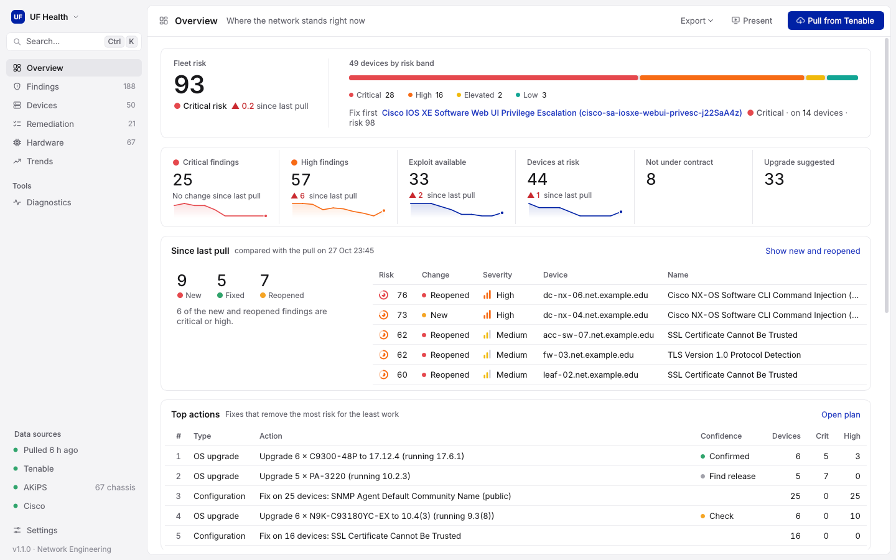
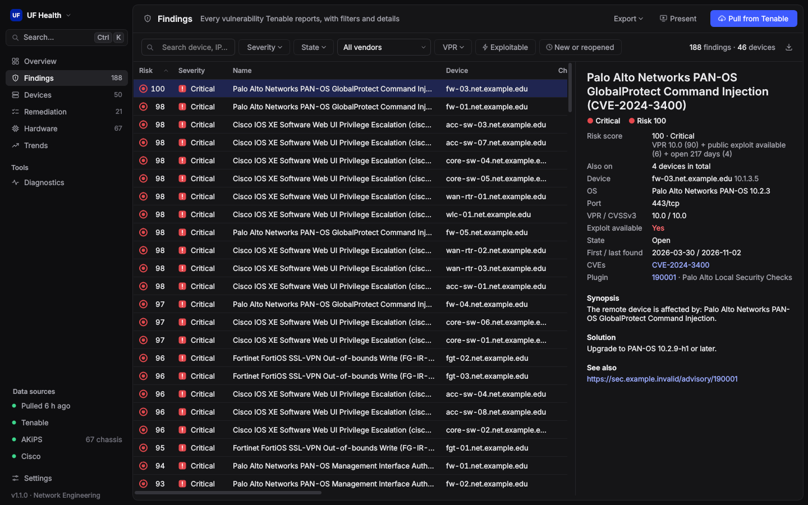
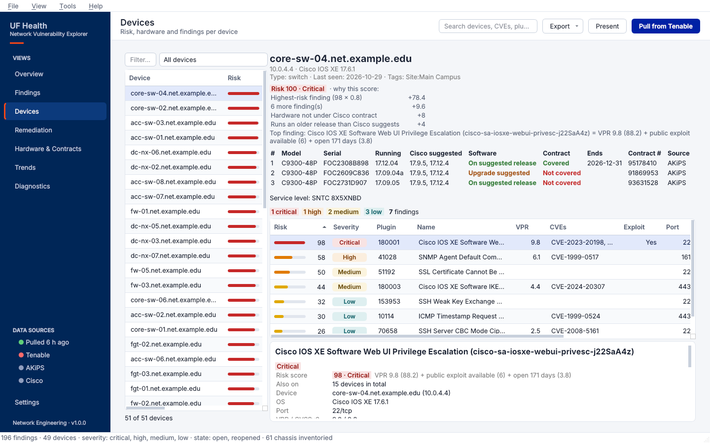
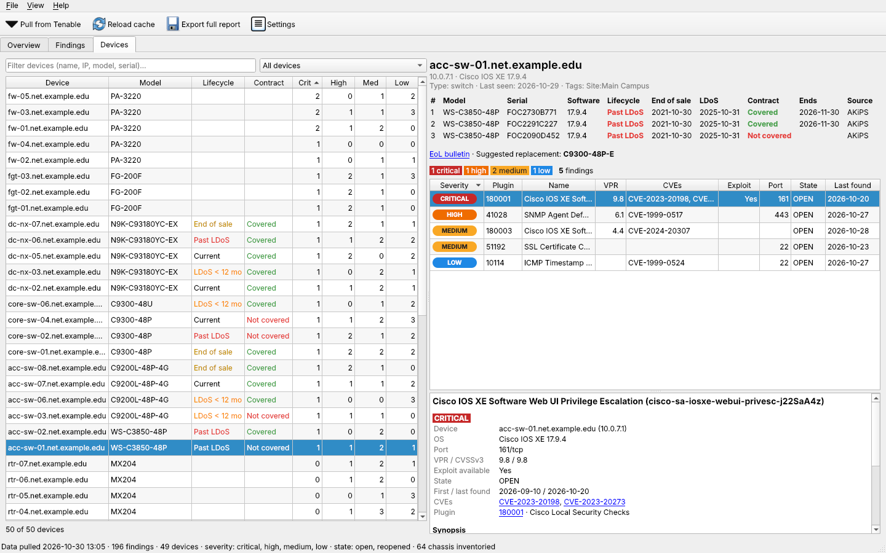

# UFH NetEng Tenable

A desktop app and command-line tool for pulling network-equipment vulnerability data from **Tenable Vulnerability Management** (cloud.tenable.com), exploring it, and turning it into CSV/Excel reports. It's a faster alternative to the web dashboard.



## Windows: one-click start

1. Download the `main` branch as a ZIP (**Code → Download ZIP**) and extract it, or clone it.
2. Double-click **`run_gui.bat`**.

The launcher:
- **Finds Python:** uses a 64-bit Python 3.10–3.14. If there isn't one, it offers to install Python 3.12 for your user via `winget`.
- **Sets up `.venv`:** creates it next to the script, and rebuilds it if it's broken.
- **Installs packages:** installs `requirements.txt` the first time, and again whenever that file changes. The first run takes a few minutes.
- **Opens the app:** after the first run, double-clicking goes straight to the app.

Nothing is installed into your system Python.

| If… | Do this |
|---|---|
| The app doesn't open or closes immediately | Run `run_gui.bat debug` from a Command Prompt to see errors in the console. Crashes are also logged to `logs\gui-error.log`. |
| Installing packages fails | Read the end of `logs\setup.log`. Behind a proxy, run `set HTTPS_PROXY=http://your-proxy:port` in a Command Prompt, then run `run_gui.bat` from that window. |
| Something is half-installed | Delete the `.venv` folder and run `run_gui.bat` again. |

Your API keys, the `cache\` folder and reports all live in the project folder next to `run_gui.bat`.

## How it works

1. **`pull`** uses Tenable's **bulk export API** (via the official [pyTenable](https://github.com/tenable/pyTenable) SDK). Tenable builds the dataset server-side in chunks, and pyTenable downloads them, polls for completion, and backs off on rate limits. This is much faster than paging through the UI.
2. The raw JSON is cached in `cache/`. Every other command reads from that cache, so you can run as many reports or lookups as you like without calling the API again.
3. Records are flattened into a pandas DataFrame with one row per finding (device × plugin × port). The tool then rolls them up by device, plugin, CVE, and vendor/OS.

The tool sees exactly what your API key's account can see. If your account is scoped to network equipment, every report covers only network equipment, so you don't need a filter.

## Setup

```bash
python3 -m venv .venv
```

```bash
source .venv/bin/activate
```

```bash
pip install -r requirements.txt
```

```bash
cp .env.example .env
```

Put your keys in `.env` (Tenable: **Settings → My Account → API Keys**). You can also enter them in the desktop app under **API keys…**, which writes the same file. `.env` is in `.gitignore`, so it won't be committed. You can also export `TIO_ACCESS_KEY` and `TIO_SECRET_KEY` as environment variables instead.

Run commands from the project folder: the cache (`cache/`) and `.env` are found relative to the current directory.

## Desktop app

```bash
python -m tenable_net gui
```

This is a native Qt (PySide6) app for Windows, macOS, and Linux. It reads the same `cache/` as the CLI, so data you pull in one is visible in the other.

| Tab | What you can do |
|---|---|
| **Overview** | See KPI cards, a findings-by-severity chart, a severity-by-vendor chart, the most exposed devices, and the most widespread vulnerabilities. Click a severity bar to filter Findings to that severity. Double-click a device to open it. Double-click a vulnerability to list every device that has it. |
| **Findings** | Filter live by severity, state, vendor, minimum VPR, exploit available, and free-text search (device, IP, plugin name/ID, CVE, OS; every word must match). Every column sorts. The detail pane shows the synopsis, solution, ports, and dates, with clickable CVE (NVD), Tenable plugin, and advisory links. **Export view…** saves exactly the rows on screen to Excel or CSV. |
| **Devices** | Search the device list (worst first, including inventory devices with no findings). Pick a device to see its OS, tags, last seen, severity badges, and every finding with details. |



- **Pull from Tenable** (Ctrl+P) lets you choose severities, states, a last-seen window, plugin output, and whether to refresh the asset inventory. The export runs in the background with live record counts and can be cancelled. If you cancel or the pull fails, your previous cache is kept.
- **Export full report** (Ctrl+E) writes the multi-sheet Excel report described below and opens the folder.
- **Settings…** has a tab each for Tenable, AKiPS and Cisco credentials, each with **Test connection** to check them before saving.
- **View → Theme** switches between System, Light, and Dark. Ctrl+F jumps to search and F5 reloads the cache.



## Hardware inventory & Cisco lifecycle (optional)

The tool can also show each device's **model and serial numbers** (one row per chassis or stack member), plus **Cisco end-of-life dates** and **contract coverage**, next to its vulnerabilities.

| Source | Provides | Configure in `.env` (or **Settings…** in the app) |
|---|---|---|
| **AKiPS** (preferred) | Model + serial for every chassis/stack member from ENTITY-MIB, including devices Tenable doesn't know about | `AKIPS_URL`, `AKIPS_USER` (read-only, e.g. `api-ro`), `AKIPS_PASSWORD`, optional `AKIPS_CA_BUNDLE` |
| **Tenable plugin output** (fallback) | Model + serial from credentialed-scan plugins 67217 (Cisco IOS XE Version) and 47864 (Cisco IOS Version) | nothing extra |
| **Cisco Support APIs** | EoX: end of sale, end of SW maintenance, last date of support (LDoS), replacement PID. Serial Number to Info: contract covered / end date / service level | `CISCO_CLIENT_ID`, `CISCO_CLIENT_SECRET`, optional `CISCO_TOKEN_URL` / `CISCO_API_BASE` |

How it fits together:
- AKiPS devices are matched to Tenable devices **by IP, then by hostname**. When both sources have a device, AKiPS wins and Tenable plugin output fills the gaps.
- Only **Cisco** hardware is sent to Cisco's APIs. Lookups go by serial number, falling back to product ID.
- Cisco results are cached in `cache/cisco.json` for 7 days, so re-running is cheap. Use `--force` to re-query.
- Each source is optional. Without AKiPS you get Tenable-derived models/serials. Without Cisco credentials you get models and serials but no lifecycle or contract data.

```bash
python -m tenable_net inventory                 # AKiPS + Tenable inventory, then Cisco lookups
python -m tenable_net inventory --skip-akips    # Tenable plugin output only
python -m tenable_net hardware                  # lifecycle / contract summary from cache
python -m tenable_net cisco-refresh --force     # re-query Cisco, ignoring the 7-day cache
python -m tenable_net cisco-test                # check token, EoX and Serial Number to Info access
python -m tenable_net pull --with-inventory     # vuln pull + inventory in one go
```

In the app, the Pull dialog has **Hardware inventory** and **Cisco lifecycle + contract** options. The Devices tab gains Model / Lifecycle / Contract columns, a per-member hardware table with an EoL bulletin link and suggested replacement, and filters:
- **Past last day of support**
- **LDoS within 12 months**
- **Not under contract**
- **Contract ends within 90 days**
- **In AKiPS but not in Tenable** (devices your scans are missing)

The Overview shows a "Past LDoS / not covered" card, and the Excel report gets a **Hardware & Lifecycle** sheet plus model/lifecycle/contract columns on **By Device**.



### Troubleshooting enrichment

Start with **Settings → Cisco → Test connection**, or `python -m tenable_net cisco-test`. It checks each piece separately:

| Check | What a failure means |
|---|---|
| **Token** | Wrong client ID/secret, or a blocked token URL (`CISCO_TOKEN_URL`). |
| **EoX** | Tested with a known end-of-life PID, plus a model from your inventory. `HTTP 403` means the EoX API isn't enabled for your Cisco API app. Request it in the Cisco API Console. |
| **Serial Number to Info** | Contract lookup, tested with a serial from your inventory. `HTTP 403` means that API isn't enabled. "No record" means the serial isn't linked to your contracts or Smart Account. "Skipped" means no serial numbers have been collected yet. |

Notes:
- **Contract coverage needs serial numbers.** When AKiPS or Tenable supplies only models, you still get EoX dates by product ID, but not contract status.
- **The pull log reports counts per source.** For example: chassis with a model / with a serial, how many are Cisco, how many serials and product IDs were sent, and how many came back with data. If a step fails, the Pull dialog stays open with the warning instead of closing.
- **If AKiPS shows models but no serials:**
  1. Run `python -m tenable_net inventory --dump-samples`.
  2. Open `cache/samples/akips_device_*.txt`. These list every attribute AKiPS holds for devices that have a model but no serial. Find the line with the serial number.
  3. Share that line (scrubbed), so the attribute can be added. The tool already tries `ENTITY-MIB.entPhysicalSerialNum`, `OLD-CISCO-CHASSIS-MIB.chassisId` and `CISCO-STACK-MIB.chassisSerialNumberString`.
- **Cisco results are cached.** Results that came back with data are kept 7 days. Lookups that returned nothing are retried after 1 day. To re-query right away, tick "Re-query Cisco" in the Pull dialog, or run `cisco-refresh --force`.

## Command line

```bash
# 1. Pull open + reopened findings, low severity and above (the default)
python -m tenable_net pull

# Narrow the pull
python -m tenable_net pull --severity critical high --since 30
python -m tenable_net pull --state open reopened fixed --plugin-output

# 2. Terminal overview: severity totals, worst devices, top plugins, vendor/OS breakdown
python -m tenable_net summary --top 25

# 3. Excel + CSV reports (output/<timestamp>/)
python -m tenable_net report
python -m tenable_net report --out reports/weekly --no-xlsx

# 4. Look up one device (hostname substring or exact IP)
python -m tenable_net device core-sw-01
python -m tenable_net device 10.0.0.1

# 5. Which devices are affected by a CVE, plugin ID, or plugin-name text?
python -m tenable_net search CVE-2023-20198
python -m tenable_net search 180001
python -m tenable_net search "snmp"
```

Add `--refresh` to `summary`, `report`, `device`, or `search` to pull fresh data first. Add `--include-info` to include informational findings, which are excluded by default. Run any command with `-h` to see its options.

### Excel workbook sheets

| Sheet | Contents |
|---|---|
| Severity Summary | Number of findings and affected devices for each severity |
| By Device | Critical/high/medium/low counts, max VPR, exploitable count, and last seen for each device |
| By Plugin | Each plugin with its affected device count, max VPR, CVSSv3, CVEs, and solution |
| By CVE | Each CVE with its affected device count and related plugins |
| By Vendor-OS | Roll-up by vendor (Cisco, Juniper, Palo Alto, …) and OS version |
| Findings | Every finding, with synopsis, solution, port, and first/last found |
| Assets | Asset inventory from the asset export, including devices that have no findings |

Every sheet has a frozen header row and auto-filters.

## Development

```bash
pip install pytest
```

```bash
python -m pytest -q
```

The tests run against sample export records in `tests/fixtures/` and don't need API access. The GUI tests run headless (`QT_QPA_PLATFORM=offscreen`) and are skipped if PySide6 isn't installed. On a bare Linux server, Qt also needs `libegl1`, `libgl1`, `libxkbcommon0`, and `libfontconfig1`.

You can also install the project as a package. That puts `tenable-net` and `tenable-net-gui` on your PATH:

```bash
pip install -e ".[gui,dev]"
```

## Layout

```
tenable_net/
  client.py      TenableIO client built from env / .env
  export.py      bulk vuln + asset exports, JSON cache
  normalize.py   flatten export records into DataFrames; vendor detection
  reports.py     rollups + CSV/XLSX writer
  summaries.py   rich terminal tables, device/search lookups
  cli.py         argparse entrypoint
  akips.py       read-only AKiPS client; ENTITY-MIB chassis/stack-member parsing
  inventory.py   Tenable inventory plugins, AKiPS↔Tenable matching, lifecycle/contract rollups
  cisco.py       Cisco Support API client (EoX, Serial Number to Info) with 7-day cache
  gui/
    app.py       main window, theme, toolbar/menu actions
    overview.py  KPI cards, charts, top devices/plugins
    findings.py  filter sidebar, findings table + detail pane
    devices.py   device list and per-device drill-down
    dialogs.py   pull dialog (background thread) and Tenable / AKiPS / Cisco settings
    models.py    DataFrame-backed Qt table models
    filters.py   pandas filtering behind the Findings tab
    widgets.py   severity pills, KPI cards, detail pane, worker thread
```
