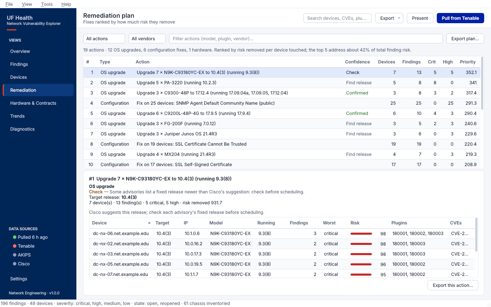
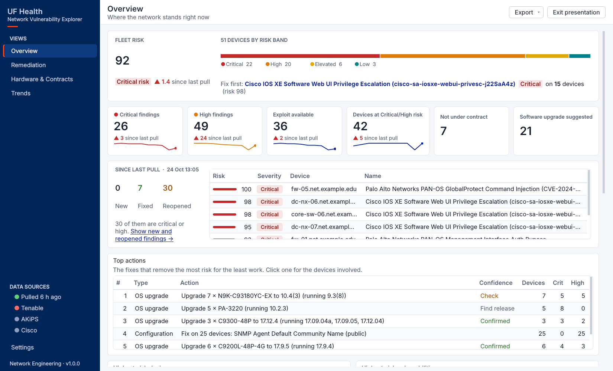
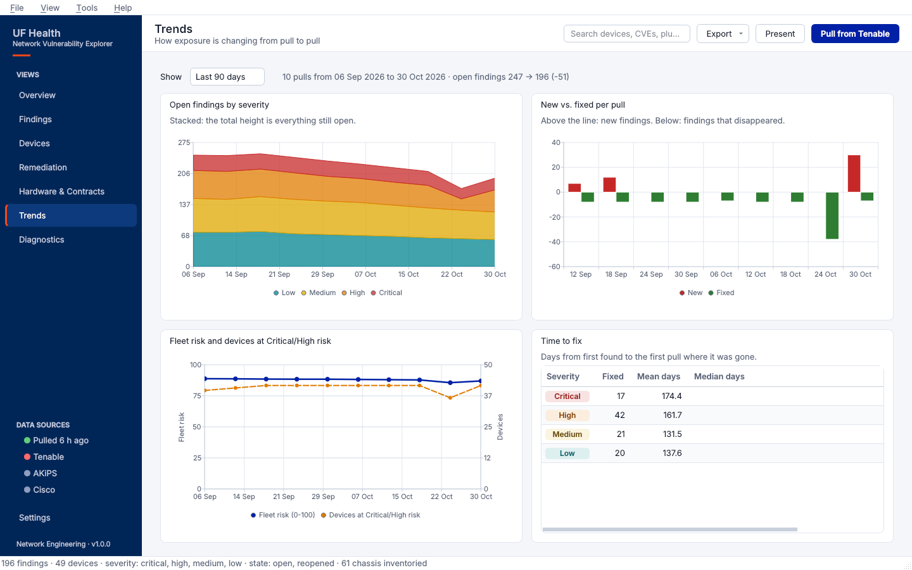
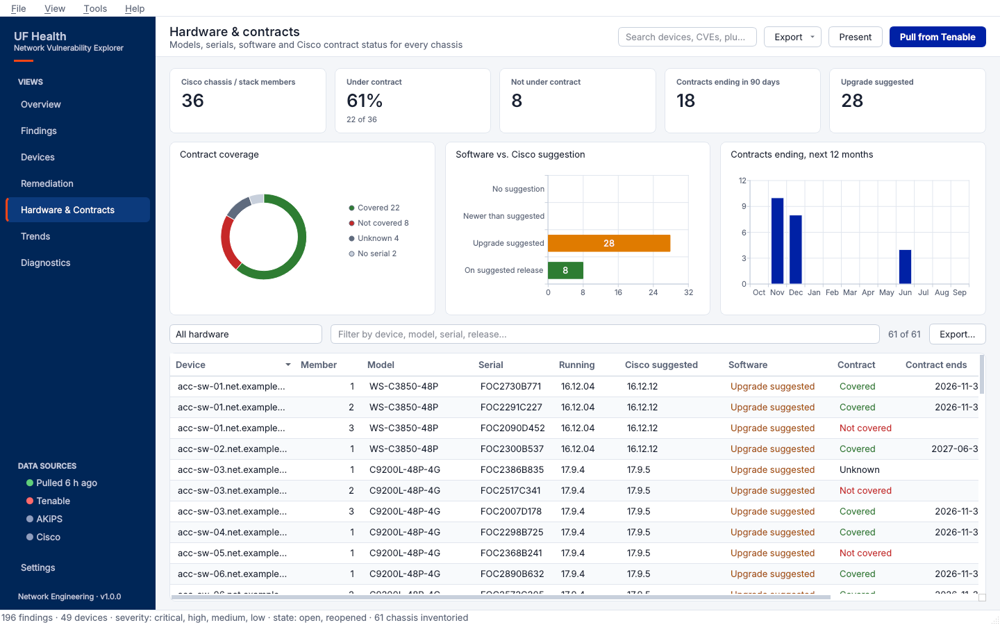

# UFH NetEng Tenable

A desktop app and command-line tool for pulling network-equipment vulnerability data from **Tenable Vulnerability Management** (cloud.tenable.com), exploring it, and turning it into CSV/Excel reports. It's a faster alternative to the web dashboard.


## Windows: one-click start

1. Download the `main` branch as a ZIP (**Code → Download ZIP**) and extract it, or clone it.
2. Double-click **`run_gui.bat`**.

The launcher:
- **Finds Python:** uses a 64-bit Python 3.10–3.14. If there isn't one, it offers to install Python 3.12 for your user via `winget`.
- **Sets up `.venv`:** creates it next to the script, and rebuilds it if it's broken.
- **Installs packages:** installs `requirements.txt` the first time, and again whenever that file changes. The first run takes a few minutes.
- **Opens the app:** after the first run, double-clicking goes straight to the app.

Nothing is installed into your system Python.

| If… | Do this |
|---|---|
| The app doesn't open or closes immediately | Run `run_gui.bat debug` from a Command Prompt to see errors in the console. Crashes are also logged to `logs\gui-error.log`. |
| Installing packages fails | Read the end of `logs\setup.log`. Behind a proxy, run `set HTTPS_PROXY=http://your-proxy:port` in a Command Prompt, then run `run_gui.bat` from that window. |
| Something is half-installed | Delete the `.venv` folder and run `run_gui.bat` again. |

Your API keys, the `cache\` folder and reports all live in the project folder next to `run_gui.bat`.

### Updating

Double-click **`update.bat`**. It checks GitHub for a newer version of `main`, shows the version number and the list of changes, and asks before installing. Then it offers to start the app. The next start of `run_gui.bat` installs any new requirements automatically.

- **Downloaded as a ZIP?** The first run offers to link the folder to GitHub. After that, every update is one click. Program files are replaced with the latest version.
- **Never touched:** your `.env`, `cache\`, reports, `logs\` and `.venv\`.
- **Edited a program file yourself?** You can keep your change (it's set aside, the update is applied, then your change is re-applied), discard it, or cancel.
- **Needs Git for Windows.** If it's missing, `update.bat` offers to install it with `winget`. The first fetch may open a browser so you can sign in to GitHub.
- **Other branches:** `update.bat <branch>` follows a different branch.

## How it works

1. **`pull`** uses Tenable's **bulk export API** (via the official [pyTenable](https://github.com/tenable/pyTenable) SDK). Tenable builds the dataset server-side in chunks, and pyTenable downloads them, polls for completion, and backs off on rate limits. This is much faster than paging through the UI.
2. The raw JSON is cached in `cache/`. Every other command reads from that cache, so you can run as many reports or lookups as you like without calling the API again.
3. Records are flattened into a pandas DataFrame with one row per finding (device × plugin × port). The tool then rolls them up by device, plugin, CVE, and vendor/OS.

The tool sees exactly what your API key's account can see. If your account is scoped to network equipment, every report covers only network equipment, so you don't need a filter.

## Setup

```bash
python3 -m venv .venv
```

```bash
source .venv/bin/activate
```

```bash
pip install -r requirements.txt
```

```bash
cp .env.example .env
```

Put your keys in `.env` (Tenable: **Settings → My Account → API Keys**). You can also enter them in the desktop app under **API keys…**, which writes the same file. `.env` is in `.gitignore`, so it won't be committed. You can also export `TIO_ACCESS_KEY` and `TIO_SECRET_KEY` as environment variables instead.

Run commands from the project folder: the cache (`cache/`) and `.env` are found relative to the current directory.

## Desktop app

```bash
python -m tenable_net gui
```

This is a native Qt (PySide6) app for Windows, macOS, and Linux, in UF Health colours (light and dark). It reads the same `cache/` as the CLI, so data you pull in one is visible in the other. When the CLI updates the cache, the app reloads automatically.

The navy sidebar holds the views, a **Data sources** panel (how old the data is, plus Tenable / AKiPS / Cisco status; click one to open Settings or Diagnostics) and **Settings**. The top bar has a global search (**Ctrl+K**: devices, CVEs, plugins, models, serials), **Export**, **Present** and **Pull from Tenable**. Almost every number, bar and row is clickable and opens the list behind it, already filtered.

| View | What you can do |
|---|---|
| **Overview** | Fleet risk score and band, devices by risk band, and the single fix that matters most. KPI cards (critical, high, exploitable, devices at risk, not covered, upgrade suggested) show the change since the last pull and a sparkline. Also: what changed since the last pull (new / fixed / reopened), the top remediation actions, the highest-risk devices and vulnerabilities, and charts by severity and vendor. A getting-started checklist shows until Tenable, AKiPS and Cisco are set up. |
| **Findings** | Every finding, highest risk first. Filter by severity, state, vendor, minimum VPR, exploit available, *new or reopened only*, and free text (device, IP, plugin name/ID, CVE, OS; every word must match). The detail pane explains the risk score and shows how many devices share the finding, with CVE (NVD), Tenable plugin and advisory links. **Export view…** saves exactly the rows on screen. |
| **Devices** | Devices ranked by risk, including inventory devices with no findings. Each device shows *why this score* (its itemised breakdown), a risk trend from history, hardware and contract details, why enrichment stopped (if it did), and every finding. |
| **Remediation** | Fixes ranked by how much risk they remove per device touched (see below). Filter by type, vendor or text. Pick an action to see its devices, target release and confidence. Export one action to CSV for a change ticket, or the whole plan to Excel. |
| **Hardware & Contracts** | Contract coverage, software vs. Cisco's suggestion, and contracts ending in the next 12 months, plus the fleet table (model, serial, running vs. suggested release, contract, end date, lifecycle) with filters. Needs the hardware inventory (below). |
| **Trends** | Open findings by severity over time, new vs. fixed per pull, fleet risk vs. devices at risk, and time to fix by severity. Pick a range (30 / 90 days / all history); click a *New* bar to list the new and reopened findings. |
| **Diagnostics** | Why devices are missing hardware or Cisco data (see *Troubleshooting enrichment*). |


### Risk scores

Every finding gets a 0–100 score, and every device gets one built from its findings. They are deliberately simple so you can explain them in a meeting; the app shows the breakdown wherever a score appears.

- **Finding:** VPR (or CVSSv3, or a default for its severity) scaled to 0–90, **+6** when a public exploit exists, and up to **+4** for age (over 180 days open).
- **Device:** 80% of its worst finding, plus up to 12 points for the rest of its findings (diminishing), plus hardware points: **not under contract +8**, **past LDoS +12**, **LDoS within 12 months +5**, **software upgrade suggested +4**.
- **Bands:** Critical ≥ 75, High ≥ 50, Elevated ≥ 25, else Low. **Fleet risk** is the average of the top quarter of devices, so a few bad devices still show up.

All weights live in `WEIGHTS` in `tenable_net/risk.py`.

### History and trends

After every pull the app saves a small snapshot to `cache/history/` (the newest 90 are kept). Comparing snapshots gives the *since last pull* numbers, the **New** / **Reopened** labels in Findings, the Trends charts and time to fix. The first run after upgrading creates a snapshot from the existing cache, so trends start then; you need at least two pulls to see changes.

### Remediation plan

Findings are grouped into actions:

- **OS upgrade:** vendor OS advisories (Cisco IOS / IOS XE / NX-OS, Junos, PAN-OS, FortiOS, …) grouped by vendor and model. The target is Cisco's suggested release when known. **Confirmed** means every advisory's fixed release (from plugin output) is at or below the target; **Check** means some aren't; **Likely** means fixed releases weren't in the pulled data (pull with `--plugin-output` to confirm); **Find release** means no suggestion is known.
- **Configuration:** everything else, grouped by plugin (for example *Fix on 25 devices: SNMP Agent Default Community Name*).
- **Hardware:** renew contracts, replace hardware past or near Last Date of Support.

Actions are ranked by **risk removed ÷ √devices touched**, so a fix that closes many severe findings on a few devices comes first, without burying fleet-wide one-liners. `python -m tenable_net remediation` prints the same list.



### Meetings: presentation mode and exports

- **Present** (F11, Esc to leave) goes full screen with larger type and only Overview, Remediation, Hardware & Contracts and Trends.
- **Export → Executive summary (PDF)** writes a one-page summary: fleet risk, key numbers with changes, what changed since the last pull, top actions, highest-risk devices, hardware status, the severity chart and the open-findings trend.
- **Export → Current view as image (PNG)** for slides and emails.
- **Export → Excel report** writes the full workbook described below.



### Other controls

- **Pull from Tenable** (Ctrl+P) lets you choose severities, states, a last-seen window, plugin output, and whether to refresh the hardware inventory. The export runs in the background with live record counts and can be cancelled. If you cancel or the pull fails, your previous cache is kept. Each pull also saves a history snapshot.
- **Settings…** has a tab each for Tenable, AKiPS and Cisco credentials, each with **Test connection** to check them before saving.
- **View → Theme** switches between System, Light, and Dark. Ctrl+F jumps to the current view's search and F5 reloads the cache.



## Hardware inventory & Cisco enrichment (optional)

The tool can also show each device's **model and serial numbers** (one row per chassis or stack member) next to its vulnerabilities. For Cisco gear it adds **contract coverage**, **Cisco's suggested software release** compared with what the device runs, and optionally **end-of-life dates**.

| Source | Provides | Configure in `.env` (or **Settings…** in the app) |
|---|---|---|
| **AKiPS** (preferred) | Model + serial for every chassis/stack member from ENTITY-MIB, including devices Tenable doesn't know about | `AKIPS_URL`, `AKIPS_USER` (read-only, e.g. `api-ro`), `AKIPS_PASSWORD`, optional `AKIPS_CA_BUNDLE` |
| **Tenable plugin output** (fallback) | Model + serial from credentialed-scan plugins 67217 (Cisco IOS XE Version) and 47864 (Cisco IOS Version) | nothing extra |
| **Cisco Support APIs** | See the table below. Use whichever APIs your Cisco API app has. | `CISCO_CLIENT_ID`, `CISCO_CLIENT_SECRET`, `CISCO_APIS`, optional `CISCO_TOKEN_URL` / `CISCO_API_BASE` |

| Cisco API (`CISCO_APIS` key) | Adds | Default |
|---|---|---|
| **Serial Number to Information** (`sn2info`) | Contract covered / not covered, contract end date, contract number, service level, warranty end, covered product-line end date, base and orderable product IDs. Needs serial numbers. | on |
| **Software Suggestion v2** (`software`) | Cisco's suggested releases per model. Each device is marked *Upgrade suggested*, *On suggested release* or *Newer than suggested* by comparing them with the release it runs (`17.09.04a` and `17.9.4a` count as the same release). | on |
| **EoX** (`eox`) | End of sale, end of software maintenance, last date of support (LDoS), replacement product ID. Lifecycle columns and filters only appear when this data exists. | off |

Pick the APIs under **Settings → Cisco**. **Test connection** probes all three and ticks the ones your app can use, so you don't need to know in advance. In `.env`, set for example `CISCO_APIS=sn2info,software`.

How it fits together:
- AKiPS devices are matched to Tenable devices **by IP, then by hostname**. When both sources have a device, AKiPS wins and Tenable plugin output fills the gaps.
- Only **Cisco** hardware is sent to Cisco's APIs. A device counts as Cisco by its sysDescr, its Tenable OS, or a Cisco-shaped model number. Contract lookups go by serial number. Software suggestions go by model, plus the base product ID that the contract lookup returns.
- Cisco results are cached in `cache/cisco.json` for 7 days, so re-running is cheap. Use `--force` to re-query.
- Each source is optional. Without AKiPS you get Tenable-derived models/serials. Without Cisco credentials you get models and serials but no lifecycle or contract data.

```bash
python -m tenable_net inventory                 # AKiPS + Tenable inventory, then Cisco lookups
python -m tenable_net inventory --skip-akips    # Tenable plugin output only
python -m tenable_net hardware                  # lifecycle / contract summary from cache
python -m tenable_net cisco-refresh --force     # re-query Cisco, ignoring the 7-day cache
python -m tenable_net cisco-test                # check the token and each Cisco API
python -m tenable_net pull --with-inventory     # vuln pull + inventory in one go
```

In the app:
- **Pull dialog:** has **Hardware inventory** and **Cisco enrichment** options.
- **Hardware & Contracts view:** the whole fleet at a glance (see *Desktop app*).
- **Devices view:** gains Model / Contract / Software columns (plus Lifecycle with EoX). Each device has a per-member table showing serial, running vs. Cisco-suggested release, contract status, end date and contract number. It also has these filters:
  - **Not under contract**
  - **Contract ends within 90 days**
  - **Software upgrade suggested**
  - **In AKiPS but not in Tenable** (devices your scans are missing)
  - **Past last day of support** / **LDoS within 12 months** (with EoX)
- **Overview:** shows *Not under contract* and *Software upgrade suggested* cards, and hardware points count toward device risk scores.
- **Remediation:** adds *Renew support contract* and LDoS replacement actions.
- **Excel report:** gets a **Hardware & Lifecycle** sheet, plus contract/software columns on **By Device**.




### Troubleshooting enrichment

The **Diagnostics** view (also **Tools → Enrichment diagnostics**) shows where each device falls out of the AKiPS → Cisco pipeline:

- **Funnel:** Tenable devices → with hardware inventory → with a model → with a serial → identified as Cisco → fully enriched. It also shows the result of the last Cisco run (sent / found / rejected per API).
- **Where devices stop:** each device's first failing stage, with a plain-English reason and what to do. Click a stage to list its devices.

  | Stage | Meaning |
  |---|---|
  | **Not matched to AKiPS** | Name and IP differ; add an alias, see below. |
  | **AKiPS: no hardware data** | AKiPS isn't collecting ENTITY-MIB for the device. |
  | **AKiPS: no chassis found** | AKiPS has hardware data, but nothing that looks like a chassis with a model or serial. |
  | **No serial number** | Neither AKiPS nor Tenable reported a serial. |
  | **Not Cisco** | The device wasn't sent to Cisco. |
  | **Cisco: error** | Cisco rejected the lookup, for example a serial not entitled to your contracts. The error code is shown. |
  | **Cisco: no contract record** | Serial Number to Info returned nothing for the serial. |
  | **Software: no suggestion** | Software Suggestion had no release for the model. |
  | **Not looked up yet** | The device hasn't been sent to Cisco yet. |
- **Per-device buttons:**
  - **Show raw AKiPS data** lists everything AKiPS holds for the device, with the serial and entPhysical lines on top.
  - **Re-query Cisco for this device** refreshes just that device.
- **Unmatched AKiPS devices** lists AKiPS devices that matched nothing in Tenable. These are the candidates for aliases.
- **Export shareable report…** writes a zip of the diagnostics with hostnames, IPs and serials replaced by tokens, which is safe to send for help. **Export CSV…** writes the full table.

The command-line equivalent is `python -m tenable_net enrichment-report`. Add `--device NAME` for one device, `--csv FILE`, or `--bundle report.zip`.

**Aliases.** When an AKiPS device and its Tenable device share neither an IP nor a name or sysName, copy `device_aliases.example.csv` to `device_aliases.csv` next to `.env`. Add one `akips_device,tenable_hostname` line per device; the right side can be a hostname or an IP. `update.bat` never touches this file.

**How matching and merging work:**
- **Matching** tries an alias first, then any of the device's IPs in Tenable, then the AKiPS sysName, then the AKiPS device name.
- **Merging:** a blank serial, model or software version from AKiPS is filled from Tenable's plugin output for the same stack member.
- **Chassis detection:** AKiPS chassis are found by class, then by top-level / stack membership (`entPhysicalContainedIn`), then by name. A device with a chassis-level serial but no hardware table still gets a row.
- **Rejected values:** a serial or model that Cisco rejects only fails itself, not the rest of its batch. Errors are retried after a day.

Start with **Settings → Cisco → Test connection**, or `python -m tenable_net cisco-test`. It checks each piece separately:

| Check | What a failure means |
|---|---|
| **Token** | Wrong client ID/secret, or a blocked token URL (`CISCO_TOKEN_URL`). |
| **Serial Number to Info** | Tested with a serial from your inventory. `HTTP 403` means the API isn't enabled for your Cisco API app. "No record" means the serial isn't linked to your contracts or Smart Account. "Skipped" means no serial numbers have been collected yet. |
| **Software Suggestion** | Tested with a model from your inventory. `HTTP 403` means the API isn't enabled. "No suggestion" is normal for some products. |
| **EoX** | Tested with a known end-of-life product ID. `HTTP 403` means you don't have EoX. Leave it unticked. |

Notes:
- **Contract coverage needs serial numbers.** Software suggestions only need the model.
- **The pull log reports counts per source.** For example: chassis with a model / with a serial, how many are Cisco, how many serials and product IDs were sent, and how many came back with data. If a step fails, the Pull dialog stays open with the warning instead of closing.
- **If AKiPS shows models but no serials:**
  1. Run `python -m tenable_net inventory --dump-samples`.
  2. Open `cache/samples/akips_device_*.txt`. These list every attribute AKiPS holds for devices that have a model but no serial. Find the line with the serial number.
  3. Share that line (scrubbed), so the attribute can be added. The tool already tries `ENTITY-MIB.entPhysicalSerialNum`, `OLD-CISCO-CHASSIS-MIB.chassisId` and `CISCO-STACK-MIB.chassisSerialNumberString`.
- **Cisco results are cached.** Results that came back with data are kept 7 days. Lookups that returned nothing are retried after 1 day. To re-query right away, tick "Re-query Cisco" in the Pull dialog, or run `cisco-refresh --force`.

## Command line

```bash
# 1. Pull open + reopened findings, low severity and above (the default)
python -m tenable_net pull

# Narrow the pull
python -m tenable_net pull --severity critical high --since 30
python -m tenable_net pull --state open reopened fixed --plugin-output

# 2. Terminal overview: severity totals, worst devices, top plugins, vendor/OS breakdown
python -m tenable_net summary --top 25

# 3. Excel + CSV reports (output/<timestamp>/)
python -m tenable_net report
python -m tenable_net report --out reports/weekly --no-xlsx

# 4. Look up one device (hostname substring or exact IP)
python -m tenable_net device core-sw-01
python -m tenable_net device 10.0.0.1

# 5. Which devices are affected by a CVE, plugin ID, or plugin-name text?
python -m tenable_net search CVE-2023-20198
python -m tenable_net search 180001
python -m tenable_net search "snmp"

# 6. Ranked remediation plan (OS upgrades, configuration fixes, hardware)
python -m tenable_net remediation --top 25
```

Add `--refresh` to `summary`, `report`, `device`, or `search` to pull fresh data first. Add `--include-info` to include informational findings, which are excluded by default. Run any command with `-h` to see its options.

### Excel workbook sheets

| Sheet | Contents |
|---|---|
| Severity Summary | Number of findings and affected devices for each severity |
| By Device | Critical/high/medium/low counts, max VPR, exploitable count, and last seen for each device |
| By Plugin | Each plugin with its affected device count, max VPR, CVSSv3, CVEs, and solution |
| By CVE | Each CVE with its affected device count and related plugins |
| By Vendor-OS | Roll-up by vendor (Cisco, Juniper, Palo Alto, …) and OS version |
| Findings | Every finding, with synopsis, solution, port, and first/last found |
| Assets | Asset inventory from the asset export, including devices that have no findings |
| Remediation | The ranked action plan |
| Remediation devices | One row per device per action, for change tickets |

Every sheet has a frozen header row and auto-filters.

## Development

```bash
pip install pytest
```

```bash
python -m pytest -q
```

The tests run against sample export records in `tests/fixtures/` and don't need API access. The GUI tests run headless (`QT_QPA_PLATFORM=offscreen`) and are skipped if PySide6 isn't installed. On a bare Linux server, Qt also needs `libegl1`, `libgl1`, `libxkbcommon0`, and `libfontconfig1`.

You can also install the project as a package. That puts `tenable-net` and `tenable-net-gui` on your PATH:

```bash
pip install -e ".[gui,dev]"
```

## Layout

```
tenable_net/
  client.py      TenableIO client built from env / .env
  export.py      bulk vuln + asset exports, JSON cache
  normalize.py   flatten export records into DataFrames; vendor detection
  reports.py     rollups + CSV/XLSX writer
  summaries.py   rich terminal tables, device/search lookups
  cli.py         argparse entrypoint
  risk.py        explainable finding / device / fleet risk scores
  history.py     per-pull snapshots; new / fixed / reopened, trends, time to fix
  remediation.py group findings into ranked OS-upgrade / configuration / hardware actions
  glossary.py    plain-English definitions behind header tooltips
  diagnostics.py enrichment funnel and per-device reasons
  akips.py       read-only AKiPS client; ENTITY-MIB chassis/stack-member parsing
  inventory.py   Tenable inventory plugins, AKiPS↔Tenable matching, lifecycle/contract rollups
  cisco.py       Cisco Support API client (EoX, Serial Number to Info) with 7-day cache
  gui/
    app.py       main window: sidebar, top bar, navigate(), presentation mode, exports
    theme.py     UF Health colour tokens (light/dark), type scale, stylesheet
    overview.py  fleet risk, KPI cards with change, since-last-pull, top actions, charts
    findings.py  filter sidebar, findings table + detail pane
    devices.py   device list and per-device drill-down with risk breakdown
    remediation.py  ranked action list, per-action devices, exports
    hardware.py  Hardware & Contracts charts and fleet table
    trends.py    history charts and time to fix
    executive_summary.py  one-page PDF summary
    diagnostics_window.py  enrichment diagnostics view
    dialogs.py   pull dialog (background thread) and Tenable / AKiPS / Cisco settings
    models.py    DataFrame-backed Qt table models
    filters.py   pandas filtering behind the Findings tab
    widgets.py   severity pills, KPI cards, detail pane, worker thread
```
